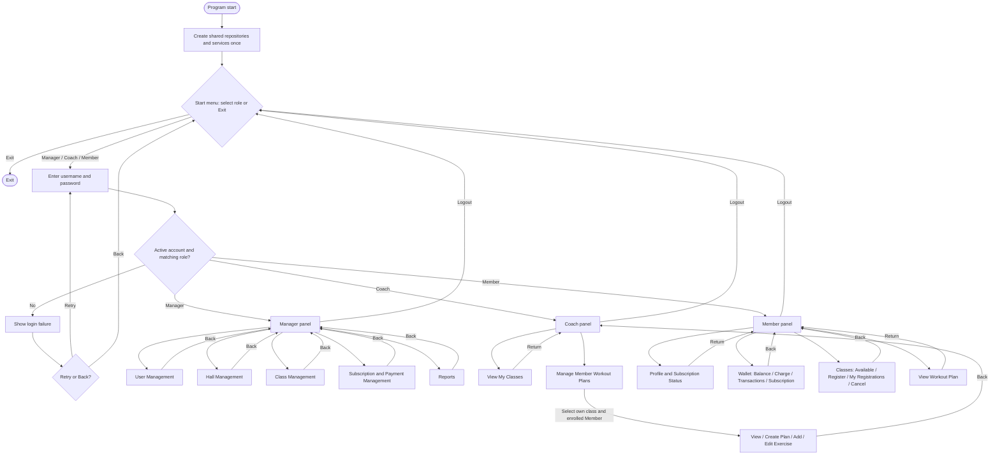

# Gym Management Application Flow

All feature menus receive the authenticated user and the same application dependencies.
Controlled feature file errors show a message and return to the parent panel.
Unavailable startup data disables the related features while other menus remain available.
Profile, class-list and workout-plan views return immediately after displaying their output.
The workout exercise menu returns to the Coach panel on Back, matching its current entry function.
